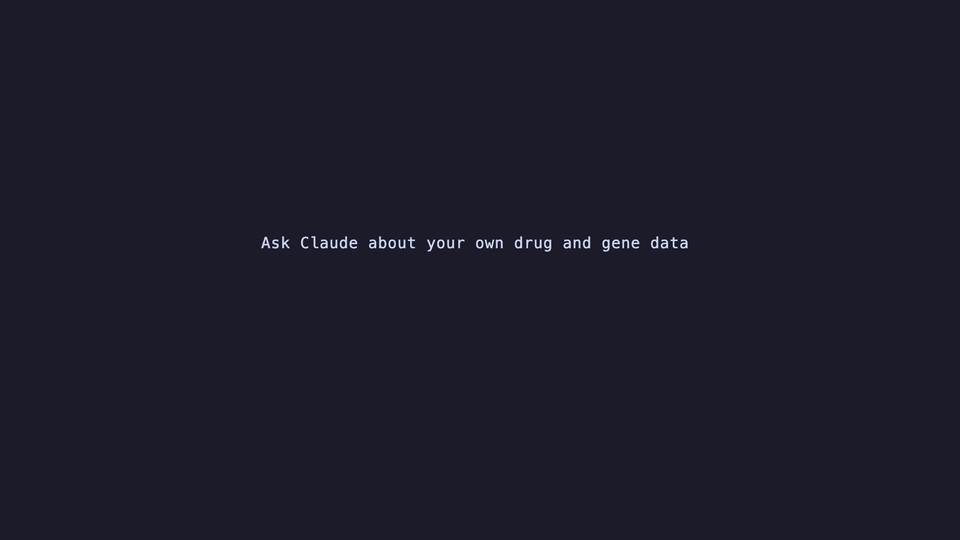

# dbparser.mcp



A local, read-only [Model Context Protocol](https://modelcontextprotocol.io/)
(MCP) server for [dbparser](https://docs.ropensci.org/dbparser/). It works
with Claude Code and Claude Desktop: the assistant can parse drug and gene
database files on your computer with dbparser, describe the tables, and tell
you each source's release, licence and the citation it asks for.

- **Local only.** The server runs over standard input and output (stdio). It
  opens no network port and has no HTTP mode.
- **Your own files only.** It reads files and folders on your computer and
  never downloads anything; URLs are refused.
- **DrugBank only from your own download.** DrugBank is not an open database:
  the server parses it only from a file you downloaded under your own DrugBank
  account and licence, never from a file inside an R package.
- **Sources keep their licences.** Every answer carries the source, release
  and licence recorded by dbparser. Each source keeps its own licence; check
  its terms before use.

## Tools

| Tool | What it does |
|---|---|
| `list_parsers` | The parsers, the files each reads, the tables it returns, the source's licence, and the bundled sample files you can try. |
| `parse_file` | Parse a local file or folder into an object kept in the server session; returns an `object_id`, the tables, `memory_mb` and the source. |
| `describe` | Tables, row counts, columns and types of a parsed object, and its full source metadata (with each file's SHA-256). |
| `list_objects` | The objects parsed in this session, their tables and memory, and the session's memory use and limit. |
| `read_table` | Rows of one table: 20 by default, at most 100 a call, paged with `offset`. Optional exact-match `filters` (see [Filters](#filters)). Always gives `returned_rows` and `total_rows` (the rows that match); text cells over 500 characters are cut, with a note naming their columns. |
| `export_csv` | Write one table to a new CSV file: the whole table, or with the same [filters](#filters) only the matching rows. It never overwrites an existing file, and the result gives each source's licence and attribution to keep with the file. |

`export_csv` is the only tool that writes anything, and only a new file at the
path you give. Names are matched exactly; an unknown parser, object or
argument value gets an error that lists the valid ones and says what to do
next.

The open-data parsers (HGNC, Health Canada DPD, openFDA, OnSIDES, TWOSIDES,
HPO) can be tried on small sample extracts bundled with dbparser, so a new
user needs no downloads; `list_parsers` gives their paths.

## Install

dbparser.mcp needs dbparser 2.3.0 or later.

``` r
# install.packages("pak")
pak::pak("interstellar-egypt/dbparser.mcp")
```

While dbparser 2.3.0 is not yet on CRAN, the package's `DESCRIPTION` has a
`Remotes: ropensci/dbparser@v2.3` line so it installs from GitHub. That line is
removed before any CRAN release.

The dbparser download from GitHub is large, and R's default 60-second
download timeout can cut it off. Raise the timeout first. This is needed only
while dbparser 2.3.0 is installed from GitHub:

``` r
options(timeout = 600)
# install.packages("remotes")
remotes::install_github("interstellar-egypt/dbparser.mcp")
```

## Set up

**Claude Code** (in a terminal):

``` sh
claude mcp add -s user dbparser -- Rscript -e "dbparser.mcp::serve()"
```

Check with `claude mcp list`, which should show `dbparser: ... ✔ Connected`.

**Claude Desktop:** Claude Desktop starts servers without your shell's
`PATH`, so give the full path to `Rscript`. Find it with:

``` sh
Rscript -e 'cat(file.path(R.home("bin"), "Rscript"), "\n")'
```

Then add a `dbparser` entry under `mcpServers` in `claude_desktop_config.json`
(macOS: `~/Library/Application Support/Claude/claude_desktop_config.json`;
Windows: `%APPDATA%\Claude\claude_desktop_config.json`). Keep the other
settings in the file as they are:

``` json
{
  "mcpServers": {
    "dbparser": {
      "command": "/Library/Frameworks/R.framework/Resources/bin/Rscript",
      "args": ["-e", "dbparser.mcp::serve()"]
    }
  }
}
```

Quit Claude Desktop fully and reopen it; it reads `mcpServers` only at start.
The six dbparser tools then show in a new chat's tools menu. If they don't,
the server's log is `~/Library/Logs/Claude/mcp-server-dbparser.log` on macOS
(`%APPDATA%\Claude\logs` on Windows).

## A walk-through

Ask in plain words; the assistant picks the tools. For example:

1. *"Which databases can the dbparser server read?"* (`list_parsers`)
2. *"Parse my HGNC download, ~/data/hgnc_complete_set.txt, with
   ~/data/withdrawn.txt as the withdrawn file, release 2026-10."*
   (`parse_file`)
3. *"What tables and columns does it have, and what licence is it under?"*
   (`describe`)
4. *"Show me the first rows of the gene table."* (`read_table`)
   *"Which genes have the alias PD1?"* (`read_table` with `filters`)
5. *"Save the whole gene table to ~/data/hgnc_gene.csv."* (`export_csv`)

On an M1 Max MacBook Pro, parsing the full downloads of October 2026 gave:

| Source | Parse | `memory_mb` | Largest table |
|---|---|---|---|
| HGNC (complete set + withdrawn) | 2 s | 84 | `gene_name`, 200,034 rows |
| Health Canada DPD (all four extracts + inactive) | 6 s | 70 | `status`, 175,477 rows |
| openFDA (Drugs@FDA + NDC) | 42 s | 283 | `ndc_openfda`, 971,477 rows |

## Filters

`read_table` and `export_csv` take an optional `filters` argument: a list of
`{column, value}`.

- **Exact match.** A row is kept when the column equals the value exactly:
  same case, no partial or fuzzy matching. Column names are checked exactly;
  an unknown name is an error that lists the valid ones.
- **A value can be a list** of up to 100 values, and a row matches if it
  equals any of them. For more than 100, split them over several calls or
  export the table and filter the CSV.
- **Filters on different columns combine with AND.**
- The result names the filter used and gives the rows returned against the
  rows that match, e.g. *"Filter: symbol in (PDCD1, SNCA, SPATA2). 3 of 3
  matching row(s) returned."*

For example, to find which genes have the name PD1 among the 200,034 rows of
HGNC's `gene_name` table, and then save those genes' full records:

```json
{"table": "gene_name", "filters": [{"column": "name", "value": ["PD1"]}]}
{"table": "gene", "filters": [{"column": "symbol", "value": ["PDCD1", "SNCA", "SPATA2"]}],
 "path": "~/Desktop/pd1_genes.csv"}
```

There is no other query tool: the assistant sees at most 100 rows a call. For
counting, grouping or partial matches over a whole table, export it with
`export_csv` and analyse the CSV.

## Demo script

`demo.R` is a small MCP client: it starts the server just as Claude Code and
Claude Desktop do, sends JSON-RPC over stdio and calls every tool, printing
each call and its answer. With no arguments it uses the HGNC sample bundled
with dbparser; give a parser and paths to run it on your own files. It needs
the processx package.

``` sh
DEMO=$(Rscript -e 'cat(system.file("scripts", "demo.R", package = "dbparser.mcp"))')
Rscript "$DEMO"
Rscript "$DEMO" parseHGNC ~/data/hgnc_complete_set.txt ~/data/withdrawn.txt
Rscript "$DEMO" parseHealthCanadaDPD ~/data/health_canada_dpd
```

The CSV export goes to a temp folder. The last line checks that the server
wrote nothing to stdout but JSON-RPC.

## Memory

Parsed objects stay in memory until the server stops (restarting the client
restarts the server). `parse_file` reports each object's `memory_mb`, and
`list_objects` the session's total. Parsing takes more memory than the result
keeps: the openFDA parse above returns a 283 MB object, but the R process
grew to about 3 GB while parsing and stays near that size (even after
`gc()`) until the server stops. A full DrugBank XML takes several minutes and
several GB. Before a new parse the server checks the parsed objects already
loaded (the sum of their `memory_mb`, not the process size) and refuses when
the total is over `DBPARSER_MCP_MAX_MB` (default 4000), asking you to start a
new session. Restarting the client frees the memory.

## Not yet supported

- **Claude Science:** not yet verified; its MCP setup has not been checked
  against this server.
- **ChatGPT:** ChatGPT connects to MCP servers over HTTPS (or through
  OpenAI's Secure MCP Tunnel), not to a local stdio server, so this package
  does not work with it.

## Licence

MIT. The server code only; each database keeps its own licence.
